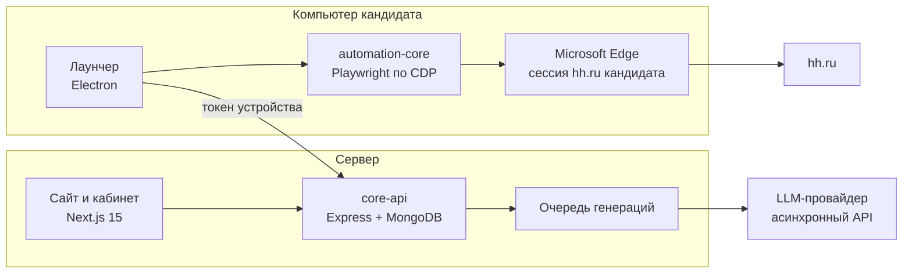

# Откликс — AI-автопилот поиска работы на hh.ru

Сервис, который ищет работу вместо человека: подбирает вакансии под резюме, отсеивает неподходящие, пишет сопроводительное письмо под каждую, откликается, заполняет анкеты работодателей и ведёт переписку с HR — отвечает на вопросы скринеров, а то, что может решить только сам кандидат, передаёт ему.

Коммерческий продукт, сделан в одиночку от архитектуры до оплаты: лендинг с блогом, личный кабинет, админка, API, десктопный лаунчер и ядро автоматизации. Работал в продакшене на otkliks.ru (осень 2026) с платными тарифами; лаунчер дошёл до версии 1.0.23 с автообновлением.

## Что умеет

- **Подбор вакансий.** Читает резюме прямо с hh.ru, собирает пул из подборки «похожих вакансий», поисковых запросов по резюме и глубины выдачи, отбрасывает уже обработанные и исключённые компании.
- **ИИ-отбор перед откликом.** Модель оценивает, какую долю требуемого стека реально закрывает резюме и не чужой ли основной язык вакансии. Зарплатная вилка разбирается из любого формата («от 200 000 ₽», «$3000», «до 5000 €») и сравнивается с минимумом кандидата в рублях по курсу ЦБ.
- **Сопроводительное письмо под вакансию.** Стратегия зашита в промпт: сильные стороны — уверенно, честные пробелы — только названные кандидатом, без самоуничижения (скрининг на hh в основном автоматический, и хеджирование читается как слабость).
- **Анкеты работодателей.** Вопросы hh, Google Forms и любые сторонние формы: агент снимает текстовый снимок страницы, получает от модели план действий, выполняет шаг и смотрит снова — так проходятся формы, которых он никогда не видел.
- **Переписка с работодателями.** Отвечает скринерам и людям, распознаёт отказы, приглашения и служебные сообщения hh, не зацикливается с HR-ботами, переспрашивающими одно и то же. О времени созвона не договаривается — это решает человек.
- **Вопросы человеку.** То, на что ИИ честно не может ответить, уходит кандидату в лаунчер или кабинет; ответ доставляется работодателю тем же кодом, что и автоматические.
- **Кабинет и статистика.** Отклики, приглашения (число снимается прямо с hh), отказы, лента событий, устройства, профиль, тарифы и оплата.

## Где здесь ИИ-инженерия

| Задача | Как решено |
| --- | --- |
| Модель «договаривает» с тем, кто её спросил: пишет работодателю «если нужно скорректировать письмо — уточните» | Три слоя в `outboundGuard.js`: **конверт** (модель кладёт сообщение между метками, всё после закрывающей отбрасывается) → **узкие шаблоны** (`assistantLeak.js`, бесплатно) → **отдельный запрос-проверка адресата** для новых формулировок. Режется всё с первого служебного предложения |
| Вызов LLM на каждое сообщение — дорого | Классификаторы двухступенчатые: дешёвая эвристика на типовые формулировки hh, LLM только для неочевидного (`outcomeClassifier.js`, `employerMessage.js`). Цена ошибки несимметрична, поэтому «отказ» — только по явным совпадениям |
| Отклики на чужой стек | ИИ-фильтр релевантности до отклика (`vacancyMatch.js`): правило «смежное можно, если закрыта хотя бы половина требований» |
| Неизвестные формы | Агентный цикл «снимок → план → шаг» на текстовом описании страницы вместо скриншотов и vision-модели (`external/formAgent.js`) |
| Ключ провайдера на компьютере клиента | Лаунчер не знает ключа: все генерации идут через `core-api` (`/api/agent/generate`), который проверяет устройство, тариф и дневной лимит |
| Пиковая нагрузка на провайдера | Очередь генераций с приоритетами: платные и проверка живости — первыми, бесплатные — следом, с потолком ожидания (`aiQueue.js`) |
| Дневной лимит откликов обходится переводом часов | Счётчик ведёт сервер, атомарно: сброс на новый день по МСК и инкремент с условием `count < cap` в одном запросе к MongoDB |
| Провайдер отдаёт текст лимита вместо ответа | Ошибки провайдера распознаются и не уходят работодателю (`llm/aiErrorText.js`) |

## Архитектура



Сессия hh.ru, куки и содержимое страниц не покидают компьютер кандидата: на сервер уходят только тексты для генерации и события для статистики.

**Модульный монолит, а не микросервисы.** Один разработчик, одна база, одна команда деплоя. Границы проведены пакетами, а не сетью: `automation-core` не знает, где он запущен.

**Внедрение зависимостей в ядре.** Хранилище, браузер, LLM-клиент и уведомления передаются в `automation-core` параметрами конструктора. Поэтому одна и та же логика работает в лаунчере (SQLite, локальный Edge, LLM через `core-api`) и годится для облачного режима (MongoDB, браузер на сервере, прямой клиент).

**Сессии.** Веб-сессия — JWT на 30 дней, которая тихо продлевается, пока человек пользуется сервисом. Лаунчер привязывается к аккаунту отдельным токеном устройства (`deviceId.secret`, в базе только bcrypt-хеш секрета) и по нему же сам берёт свежую сессию.

## Монорепозиторий

| Путь | Что внутри |
| --- | --- |
| `packages/automation-core` | Вся логика работы с hh.ru: сбор вакансий, отклик, письма, анкеты, переписка, классификаторы, защита исходящих |
| `apps/local-agent` | Лаунчер на Electron: вход, привязка устройства, планировщик кругов (отклики и чаты), лента событий, вопросы человеку, исключения и чёрный список, автозапуск с Windows, автообновление |
| `apps/core-api` | Express + MongoDB: регистрация и вход (почта, Яндекс, VK), тарифы и оплата (ЮMoney), устройства, LLM-прокси с очередью и лимитами, события и статистика, промокоды, партнёрская программа, письма |
| `apps/marketing-site` | Next.js 15 (App Router): лендинг, блог на MDX, кабинет `/app`, админка (пользователи, блог, SEO-ядро, конкуренты, партнёры), консультант на ИИ, sitemap, JSON-LD, `llms.txt`, IndexNow |

Объём: около 28 700 строк кода (JavaScript и TypeScript) без зависимостей.

## Стек

**ИИ:** LLM через асинхронный API (отправка задачи → опрос результата), агентные циклы, классификация, промпт-инженерия с проверкой вывода.
**Автоматизация:** Playwright поверх Chrome DevTools Protocol, настоящий Microsoft Edge с профилем пользователя.
**Бэкенд:** Node.js 22, Express, MongoDB (Mongoose), JWT, bcrypt, nodemailer, helmet.
**Фронтенд:** Next.js 15, React 19, TypeScript, CSS без фреймворков, MDX.
**Десктоп:** Electron 43, SQLite (`node:sqlite`), автообновление архивом с проверкой SHA-512.
**Инфраструктура:** pnpm workspaces, Docker Compose, PM2, Nginx.

## Запуск

Нужны Node.js 22.5+, pnpm 11 и MongoDB на `127.0.0.1:27017`.

```powershell
pnpm install
copy apps\core-api\.env.example apps\core-api\.env                  # AUTH_SECRET и ключ LLM-провайдера
copy apps\marketing-site\.env.example apps\marketing-site\.env.local  # тот же AUTH_SECRET
pnpm dev:core-api       # http://localhost:4000
pnpm dev:marketing      # http://localhost:3000
pnpm dev:local-agent    # лаунчер в режиме разработки ходит на localhost
```

Адрес LLM-провайдера задаётся `SIBERI_BASE_URL`. Без SMTP письма просто логируются, без ключей ЮMoney оплата отвечает «временно недоступна» — остальное работает.

Деплой на сервер — [DEPLOY.md](DEPLOY.md).
